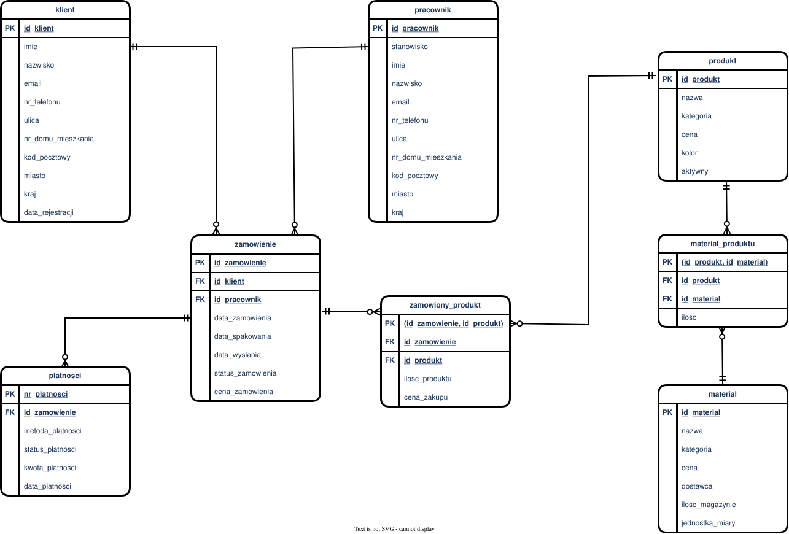

# Handmade E-commerce Database & SQL Analytics

## Project Overview

Relacyjna baza danych PostgreSQL zaprojektowana dla małego przedsiębiorstwa zajmującego się sprzedażą produktów handmade.

Projekt łączy modelowanie relacyjnych baz danych, implementację logiki biznesowej, analitykę danych w SQL oraz kontrolę jakości danych.

Głównym celem projektu jest obsługa procesów sprzedażowych oraz analiza aktywności klientów, popularności produktów i efektywności realizacji zamówień.

## Technologies

- PostgreSQL
- SQL
- PL/pgSQL
- pgAdmin
- Draw.io

## Key Features

- Relacyjny model danych składający się z 8 tabel.
- Integralność danych (PK, FK, UNIQUE, CHECK, NOT NULL).
- Przechowywanie historycznych cen zakupionych produktów.
- Automatyczne przeliczanie wartości zamówień.
- Weryfikacja płatności i dostępności materiałów produkcyjnych.
- Widoki analityczne i operacyjne (Views).
- Funkcje, triggery i kursory.
- Zarządzanie transakcjami (COMMIT, ROLLBACK).
- Analiza danych biznesowych (Business Analytics).
- Kontrola jakości danych (Data Quality Checks).

## Database Schema

| Tabela | Opis |
|---|---|
| `klient` | Dane klientów |
| `pracownik` | Dane pracowników |
| `produkt` | Katalog produktów |
| `material` | Materiały i stany magazynowe |
| `zamowienie` | Zamówienia klientów |
| `platnosci` | Informacje o płatnościach |
| `zamowiony_produkt` | Pozycje zamówień i historyczne ceny |
| `material_produktu` | Materiały wymagane do produkcji |

### Entity Relationship Diagram (ERD)

Model wykorzystuje relacje one-to-many (1:N) oraz tabele
pośredniczące do reprezentowania relacji many-to-many (N:M).

## Repository Structure

    handmade-shop-database/
      ├── docs/
      │   ├── ERD.drawio
      │   └── ERD.drawio.svg
      ├── sql/
      │   ├── 01_schema.sql
      │   ├── 02_functions.sql
      │   ├── 03_triggers.sql
      │   ├── 04_views.sql
      │   ├── 05_cursors.sql
      │   ├── 06_sample_data.sql
      │   ├── 07_analytics.sql
      │   ├── 08_transactions.sql
      │   └── 09_data_quality.sql
      └── README.md

| Plik | Zawartość |
|---|---|
| `01_schema.sql` | Struktura bazy, relacje i ograniczenia |
| `02_functions.sql` | Funkcje realizujące logikę biznesową |
| `03_triggers.sql` | Automatyczna aktualizacja wartości zamówień |
| `04_views.sql` | Widoki analityczne i operacyjne |
| `05_cursors.sql` | Proceduralna kontrola możliwości produkcji |
| `06_sample_data.sql` | Przykładowe dane demonstracyjne |
| `07_analytics.sql` | Zapytania analityczne |
| `08_transactions.sql` | Przykłady transakcji |
| `09_data_quality.sql` | Kontrola jakości i spójności danych |

## Business Logic

### Functions

- Obliczanie całkowitej wartości zamówienia.
- Obliczanie liczby sztuk produktów w zamówieniu.
- Weryfikacja pełnego opłacenia zamówienia.
- Sprawdzanie dostępności wymaganej ilości materiału.
- Sprawdzanie możliwości wykonania określonej liczby produktów.

### Triggers

Automatyczne przeliczanie wartości zamówienia po dodaniu, aktualizacji lub usunięciu jego pozycji.

Trigger wykorzystuje funkcję obliczającą wartość zamówienia na podstawie historycznych cen zakupionych produktów.

### Cursors

Iteracyjna kontrola możliwości wykonania aktywnych produktów na podstawie dostępności materiałów produkcyjnych.

Kursor stanowi przykład programowania proceduralnego w PL/pgSQL i nie modyfikuje danych.

### Transactions

- Utworzenie zamówienia wraz z jego pozycjami.
- Rejestracja płatności i aktualizacja statusu zamówienia.
- Wycofanie aktualizacji ceny produktu za pomocą ROLLBACK.

## Views

Projekt zawiera 8 widoków wspierających raportowanie, analizę danych oraz operacje biznesowe:

- Aktywność klientów.
- Rozkład statusów zamówień.
- Miesięczna sprzedaż.
- Sprzedaż produktów.
- Sprzedaż według kategorii.
- Dostawcy materiałów.
- Podstawowe dane pracowników.
- Stany magazynowe materiałów.

## Business Analytics

Projekt zawiera 7 analiz odpowiadających na pytania biznesowe.

| Analiza | Cel | Techniki SQL |
|---|---|---|
| Monthly Sales Growth (MoM) | Dynamika miesięcznej sprzedaży | CTE, LAG, NULLIF |
| Cumulative Sales | Skumulowana wartość sprzedaży | SUM OVER, Window Frame |
| Product Ranking | Ranking produktów w kategoriach | DENSE_RANK, PARTITION BY |
| Customer Segmentation | Segmentacja klientów według wartości zakupów | CASE WHEN |
| Repeat Purchase Rate | Wskaźnik powracających klientów | Conditional Aggregation |
| Order Fulfillment Time | Średni czas pakowania i wysyłki | EXTRACT, AVG |
| Market Basket Analysis | Produkty najczęściej kupowane razem | SELF JOIN, GROUP BY |

Wskaźniki sprzedażowe bazują na wartości zamówień nieanulowanych, również tych oczekujących na płatność. Nie są więc tożsame z faktycznymi wpływami finansowymi.

## Data Quality

Zapytania kontrolujące jakość i spójność danych:

| Test | Cel |
|---|---|
| Order Value Consistency | Zgodność wartości zamówienia z sumą jego pozycji |
| Order Completeness | Wykrywanie zamówień bez produktów |
| Payment Consistency | Wykrywanie nadpłat i niedopłat w zamówieniach |
| Order Status Consistency | Zgodność statusów z datami realizacji |
| Product Material Completeness | Wykrywanie aktywnych produktów bez przypisanych materiałów |

Każde zapytanie zwraca rekordy naruszające określoną regułę biznesową. Brak wyników oznacza brak wykrytych nieprawidłowości w zakresie danego testu.

## Sample Data

Projekt wykorzystuje syntetyczny zbiór danych demonstracyjnych.

| Encja | Liczba rekordów |
|---|---:|
| Klienci | 20 |
| Pracownicy | 20 |
| Produkty | 20 |
| Materiały | 20 |
| Zamówienia | 20 |
| Płatności | 20 |

Dane obejmują różne kategorie produktów, statusy zamówień, metody płatności oraz zamówienia wieloproduktowe.

Zbiór służy do demonstracji działania bazy danych i technik analitycznych, a nie do formułowania reprezentatywnych wniosków rynkowych.

## Getting Started

### Requirements

- PostgreSQL
- pgAdmin

### Database Setup

1. Sklonuj repozytorium:

2. Utwórz nową bazę danych w PostgreSQL.

3. Połącz się z utworzoną bazą.

4. Uruchom skrypty w następującej kolejności:

       01_schema.sql
       02_functions.sql
       03_triggers.sql
       04_views.sql
       06_sample_data.sql

### Running Examples

Po utworzeniu bazy i załadowaniu danych można niezależnie
uruchomić pozostałe skrypty:

- `05_cursors.sql` — kontrola możliwości produkcji.
- `07_analytics.sql` — analizy biznesowe.
- `09_data_quality.sql` — kontrola jakości danych.
- `08_transactions.sql` — przykłady transakcji.

Skrypty transakcyjne należy uruchamiać oddzielnie, ponieważ niektóre operacje trwale modyfikują dane.

## Skills Demonstrated

**Database Development**
- Relational Database Design & ER Modeling
- Data Integrity Constraints
- SQL Functions, Triggers & Cursors
- Transaction Management

**SQL & Data Analytics**
- CTE & Window Functions
- JOINs, Subqueries & Conditional Aggregation
- Analytical Views & KPI Calculation
- Customer Segmentation & Market Basket Analysis
- Data Quality Validation
